<p align="center">
  <picture>
    <source media="(max-width: 600px) and (prefers-color-scheme: light)" srcset="./assets/hero-mobile-light.svg"/>
    <source media="(max-width: 600px)" srcset="./assets/hero-mobile-dark.svg"/>
    <source media="(prefers-color-scheme: light)" srcset="./assets/hero-light.svg"/>
    
  </picture>
</p>

<p align="center">
  <a href="mailto:tima.timur2004@gmail.com"></a>
  
  
</p>

<picture>
  <source media="(prefers-color-scheme: light)" srcset="./assets/divider-light.svg"/>
  
</picture>

### `$ cat timur.yml`

```yaml
name:        Timur Afandiyev
studying:    M2 Chemoinformatics · Université de Strasbourg
background:  Chemical Engineering & Physical Chemistry · UFAZ (French-Azerbaijani University)
focus:
  - chemical space exploration & dimensionality reduction  # PCA · t-SNE · UMAP · SOM · GTM
  - molecular representations                              # Morgan fingerprints · ISIDA descriptors · SMILES
  - process simulation & thermodynamics                    # Aspen HYSYS
speaks:      [Russian, Azerbaijani, English, French]
seeking:     master's thesis internship · chemoinformatics · CADD · molecular modelling
```

<picture>
  <source media="(prefers-color-scheme: light)" srcset="./assets/divider-light.svg"/>
  
</picture>

### `$ ls ~/toolbox`

<p align="center">
  <picture>
    <source media="(prefers-color-scheme: light)" srcset="./assets/toolbox-light.svg"/>
    
  </picture>
</p>

<picture>
  <source media="(prefers-color-scheme: light)" srcset="./assets/divider-light.svg"/>
  
</picture>

### `$ git log --graph`

<p align="center">
  <picture>
    <source media="(prefers-color-scheme: dark)" srcset="https://raw.githubusercontent.com/tafandiyev/tafandiyev/output/github-contribution-grid-snake-dark.svg"/>
    
  </picture>
</p>

<picture>
  <source media="(prefers-color-scheme: light)" srcset="./assets/divider-light.svg"/>
  
</picture>

<sub>Art is plain SVG generated by <a href="./assets/make_art.py"><code>assets/make_art.py</code></a> — edit the tool list there and re-run to update it.</sub>
